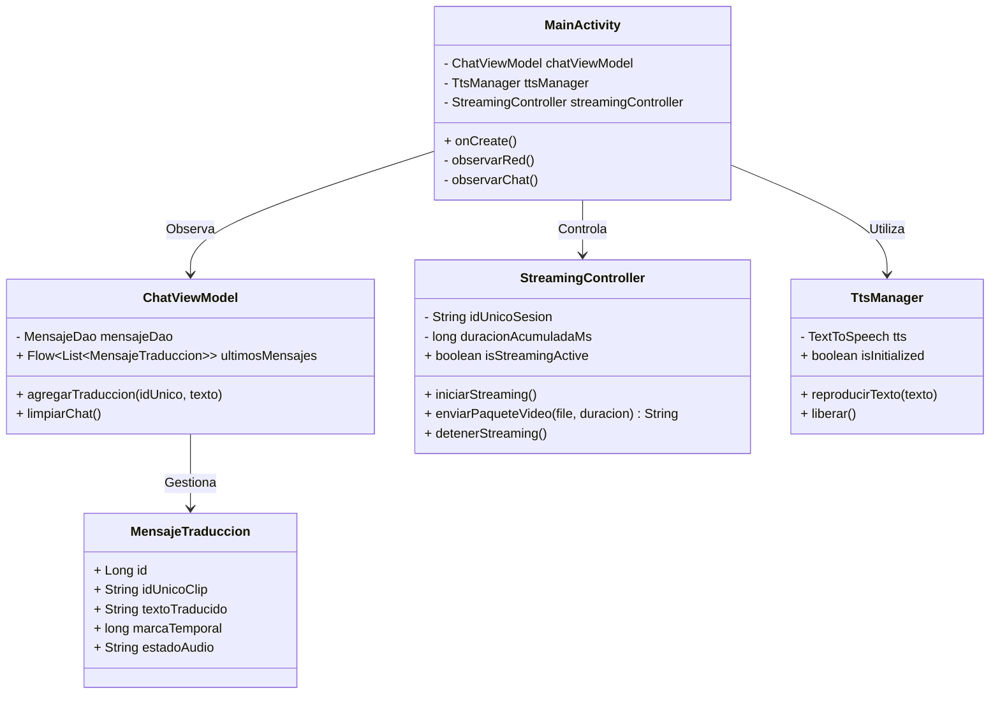

# Diagramas UML: TraductorLSEC

**Fecha**: 2026-10-21
**Proyecto**: TraductorLSEC (Aplicación Móvil Android / MVC)

## 1. Diagrama de Casos de Uso

```mermaid
actor UsuarioOyente as "Usuario Oyente (Sin conocimiento de LSEC)"
actor PersonaSorda as "Persona Sorda (Hablante de LSEC)"
actor ModeloCloud as "Modelo Cloud TFLite"

rectangle "TraductorLSEC (App Móvil Android)" {
    usecase "Otorgar Permisos de Cámara y Audio" as UC1
    usecase "Iniciar Streaming de Video por Paquetes" as UC2
    usecase "Visualizar Traducción en Chat (Máx 30)" as UC3
    usecase "Reproducir Audio TTS" as UC4
    usecase "Gestionar Errores y Baja Conexión" as UC5
}

UsuarioOyente --> UC1
UsuarioOyente --> UC2
UsuarioOyente --> UC3
UsuarioOyente --> UC4
UsuarioOyente --> UC5
PersonaSorda --> UC2
UC2 --> ModeloCloud : Envía video chunk, id_unico, duracion
ModeloCloud --> UC3 : Retorna texto traducido
```

## 2. Diagrama de Secuencia (Streaming y Traducción)

```mermaid
actor Usuario as "Usuario Oyente"
participant Vista as "MainActivity (View)"
participant Controller as "StreamingController"
participant Api as "TranslationService (Retrofit)"
participant Cloud as "Modelo Cloud TFLite"
participant DB as "Room DB / ChatViewModel"
participant TTS as "TtsManager"

Usuario->>Vista: Inicia Streaming
Vista->>Controller: iniciarStreaming()
loop Cada Paquete de Video (<= 10 min)
    Controller->>Api: enviarChunkVideo(id_unico, duracion, video_chunk)
    Api->>Cloud: POST multipart/form-data
    Cloud-->>Api: TraduccionResponseDto (texto_traducido)
    Api-->>Controller: Respuesta exitosa
    Controller->>DB: agregarTraduccion(idUnico, texto)
    DB-->>Vista: Actualiza Flow de Mensajes (Máx 30)
    Vista->>TTS: reproducirTexto(textoTraducido)
    TTS-->>Usuario: Audio generado por voz
end
```

## 3. Diagrama de Clases (Arquitectura MVC)


